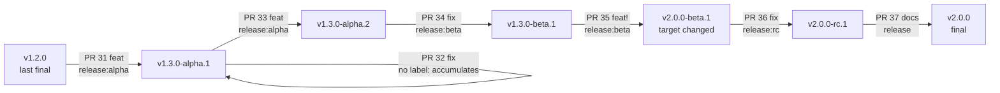

# dev-workflow

An agent skill (for Claude Code and compatible agents) plus the tooling behind it, for a traceable development workflow on GitHub — from the accepted plan to the published release — in projects of any technology.

It rests on two rules:

1. **No versioned change exists without an issue.**
2. **No version number is ever written by hand.**

Everything else in this repository exists to make those two rules cheap to follow and hard to break: a procedure the agent follows, scripts that do the mechanical work, a git hook, and GitHub Actions workflows that verify each pull request and publish releases on their own.

> **Language note.** A project picks its language with the `language` key of `.github/dev-workflow.toml`: `pt-BR` (the default when the key is absent) or `en`. `bootstrap.py init --language en` installs the workflow in English: configuration, issue forms, PR template, workflow display names and the default section names (`Version`, `Items`, `Acceptance criteria`); the required check of branch protection is then `PR check` instead of `Verificação do PR`. Default section names are accepted in either language, so switching a project's language (change the key, then run `update`; see [references/installation.md](references/installation.md#idioma)) does not break open issues and PRs, but the required check has to be renamed by hand in branch protection. Still in Portuguese: `SKILL.md`, the documents in `references/`, the comments inside the generated workflows and the script messages not yet in the catalog (`scripts/devflow/locales/`). This README is the English overview.

## What it is

| Layer | Where | Role |
|---|---|---|
| Procedure | [`SKILL.md`](SKILL.md) | What the agent does in each phase: classify, create issues, branch, commit, open the PR, decide on a release, close |
| Tooling | [`scripts/`](scripts/) | Three command-line tools that use only the Python 3.11+ standard library, `git` and `gh` |
| Enforcement | `commit-msg` hook and GitHub Actions workflows ([`assets/`](assets/)) | The barriers: a commit with no issue reference is rejected, a PR that breaks the rules fails its check |
| Project settings | `.github/dev-workflow.toml` | Everything specific to a project: issue types, required sections, version files, public surfaces, release mode |

The skill is copied into each project (`.claude/skills/dev-workflow/`) and versioned with it, because the project's CI workflows call the scripts from that copy.

## How it works

```
accepted plan ─► issues (+ epic) ─► branch <type>/<N>-<slug> ─► commits "Refs #N"
      ─► PR "Closes #N" (+ release label, if it publishes) ─► check + version preview
      ─► merge ─► evidence on the issues ─► [release] version, changelog, tag, GitHub Release
```

1. **Plan.** A plan ends with a "GitHub items" section (`Itens do GitHub`): type, title, acceptance criteria, test plan and documentation for each deliverable. Reviewing the plan means reviewing that breakdown.
2. **Issues.** Accepting the plan is the authorization: the agent creates one issue per reviewable deliverable before editing any file. Two or more issues also get an epic.
3. **Develop.** A branch is created from the issue; commits follow Conventional Commits and reference the issue.
4. **Review.** The PR follows the template and carries the `release` label only if merging it should publish a version. A check verifies the PR and comments a preview of the version.
5. **Approve.** The merge is the approval. Evidence, versioning and closing happen without intervention.

## Business rules

### Issue before any edit

- An accepted plan becomes issues before the first edit. One issue per independent, testable, reviewable deliverable — typically one PR each; never one issue per file, never mixed types in one issue.
- A direct request with no plan still needs an issue: the agent finds the existing one (number mentioned, number in the branch name, search) or creates it, even for a small change. Questions and investigations that change no file need no issue.
- Every section of the issue template is kept. A section with nothing to say is filled with "Not applicable — reason" rather than removed, because an absent section cannot tell "does not apply" from "forgotten".
- **Scope changes are explicit.** When the work grows beyond what the issue describes, either the issue body is updated and a scope-change comment is recorded (same deliverable), or a new issue is opened (another deliverable). If the change alters the type — a fix that became a feature — the label changes too, because the label decides the version.

### One type per issue, and the type decides three things

Each issue carries exactly one type label. The type determines the commit and branch prefix, the version increment the delivery asks for, and the changelog section. Factory defaults (a project can define its own in `[types]`):

| Label | When | Commit / branch prefix | Version |
|---|---|---|---|
| `bug` | Behaviour differs from what is expected or documented; regression | `fix` | patch |
| `feature` | New capability | `feat` | minor |
| `enhancement` | Improvement to something that exists | `feat` or `perf` | minor |
| `documentation` | Documentation only | `docs` | — |
| `refactor` | Restructuring with no observable change | `refactor` | — |
| `test` | Tests only | `test` | — |
| `ci` | Pipeline and checks | `ci` | — |
| `chore` | Dependencies, tooling, configuration | `chore` or `build` | — |

A `feature` labelled as `chore` ships as a patch and disappears from the changelog, so classification matters. Documentation and tests that accompany a feature or a fix belong inside that issue, as part of its definition of done.

### Epics

- A plan with two or more issues gets an `epic` issue whose "Items" section (`Itens`) lists the children in order: `- [ ] #N title — depende de #M | independente`.
- The official links are GitHub's native relationships: each child is a **sub-issue** of the epic and each dependency is a native **"blocked by"**. `github_issues.py sync-epic` reconciles the text with GitHub; it is idempotent and never replaces an existing parent.
- When a child issue closes, the `epic-checklist` workflow ticks its box in the parent epic; reopening unticks it.
- When the last open sub-issue closes, the epic closes itself — as completed if at least one child was completed, as "not planned" if all were dismissed.
- **An incomplete read never authorizes an action.** GitHub returns at most 100 sub-issues or blocking relations per page; if the list comes back truncated, the epic commands stop with an error instead of closing an epic or creating links from partial data.

### Branches and commits

- Branches are created from the up-to-date default branch and named `<prefix>/<N>-<slug>`, derived from the issue's type and title (`github_issues.py start <N>`).
- Commit messages follow Conventional Commits — `<type>(<scope>): <subject>` — with a `Refs #N` trailer.
- The `commit-msg` hook appends `Refs: #N` from the branch name and **rejects any commit that references no issue**. `--no-verify` is not used: the hook is the barrier that keeps the link.
- A breaking change is marked with `!` after the type or with a `BREAKING CHANGE:` footer. That is the marker the version automation reads.

### Pull requests

- The body follows the template, with every required section filled in (by default: issues, summary, tests executed, documentation, version). `Closes #N` marks a complete delivery, `Refs #N` a partial one. Only tests that actually ran are listed, with command and result.
- The title follows Conventional Commits: it becomes the squash commit and feeds the changelog.
- The **PR check** (`Verificação do PR`) runs on every push, edit and label change. It fails when: a referenced issue does not exist or has no type; a required section is missing or empty; a version override is used without the `release` label or without a reason; the title is not a Conventional Commit; the version files disagree with the current version. It warns, without failing, about unchecked acceptance criteria, sections missing from the issue, and a title type that differs from the issue type. Each severity is configurable.
- **The check trusts the base branch, never the PR.** It runs the skill and the configuration from the base branch; from the PR it only reads data (body, labels, commits, and the version files in a separate directory). A PR that could change its own validator could approve itself. The cost is accepted: an improvement to the validator only takes effect after it is merged.
- Whoever implements does not merge and does not close their own issue on their own initiative.

### Releases are opt-in, and only by one label

- **Only the `release` label makes a merge publish a version.** With it, the merge publishes everything accumulated since the last tag, not just that PR. Without it, nothing is published and the changes stay accumulated.
- There is no label for "does not release": the absence of `release` is the decision. Forgetting the label loses nothing — it only postpones, because the next release looks back at everything pending.
- There is no such thing as a merged PR that never ships: whatever was merged goes out in the next version.
- Every PR gets a single, updated-in-place preview comment: either "this PR publishes vX" with the table of signals, or "this PR publishes nothing; if a version were cut after this merge it would be vX".

### The tag is the version; files are projections

- The current version is **the highest version tag reachable from the branch** (`v1.4.2` with the default prefix). Everything between that tag and the branch tip is unreleased.
- Files that carry the number (`pyproject.toml`, `package.json`, `Cargo.toml`, a manifest…) are rewritten by the automation from the declarative list `[[versioning.files]]`. Nobody edits them, or the changelog, by hand: a coherence check fails on any divergence.
- The skill does not understand ecosystems. It replaces text — literal or regex — and verifies the number of occurrences, so it works with any technology and fails loudly when a file drifts.
- "What goes into the next version" is never a label or a hand-kept list; it is `tag..HEAD`. That is also why undoing a release is deleting a tag and reverting one commit.

### How the level is decided

The level is **the highest among all signals from all accumulated changes**. A fix released together with a pending feature ships as a minor.

| Signal | Level |
|---|---|
| Type label of each referenced issue (`Closes` or `Refs`) | The type's `level` (default: `bug` patch, `feature` and `enhancement` minor, others none) |
| Conventional Commits type of each commit and of the PR title | `commits.levels` (default: `feat` minor, `fix` and `perf` patch) |
| `!` after the type, or a `BREAKING CHANGE:` footer in a commit or in the PR body | major |
| `breaking-change` label on the PR | major |
| A file of a declared public surface removed or renamed | major (configurable per surface) |
| A file of a declared public surface added or modified | none by itself; the change is flagged "needs analysis" |
| A version floor declared in the code (for example `since="1.4.0"`) above the computed version | raises the level until the floor is reached; if it still falls short, the release stops with an error |

Edge rules:

- A requested release in which no signal asks for an increment (documentation only, for instance) bumps the patch: every published version gets a new number.
- **In `0.x`, a breaking change bumps the minor**, following the npm and Cargo convention, and `1.0.0` never comes out of the calculation — declaring the API stable is a maintainer's decision. `zero_major = "strict"` changes this to "a breaking change goes straight to 1.0.0".
- **Agent analysis only raises, never lowers.** For a `release` PR the agent reads the accumulated diff — all pending changes, not only the current PR — classifies each change by its effect on users, and records the result on the PR. It catches the breaking change nobody marked (a public signature changed in a `fix:` commit). Since the highest signal wins, it cannot reduce a level a human declared. It is optional: without it, the release relies on the deterministic signals and the release notes say so. With `require_analysis = true`, a change to a public surface is not published without a recorded analysis or an override. Only analyses recorded by someone with write permission or by a trusted bot count.
- **The owner has the final word, up or down**, through a `semver:major|minor|patch` label plus an `Override reason` line (`Motivo da sobreposição: ...`) in the PR's version section. The override is literal — `semver:major` on `0.5.0` publishes `1.0.0` — and the computed level, the applied level and the reason are recorded in the release notes, the tag annotation and the release commit. A version floor still applies.

### What a release does

After a `release` PR is merged, the release workflow (`Versão e release`) on the branch:

1. Finishes anything left half-done (a tag without a GitHub Release, a release commit without a tag).
2. Builds the plan: from the last final tag, lists first-parent commits, maps each to its PR, reads labels, bodies and issues, and includes commits that came in without a PR.
3. Decides the level as described above.
4. Writes the version to each declared file and a new section at the top of `CHANGELOG.md`, grouped by type, **one line per delivered issue** (not per commit), linking the issue and the PR.
5. Commits `chore(release): vX.Y.Z` with the justification in the body and pushes. If the branch moved in the meantime, it discards, updates and recomputes.
6. Creates the annotated tag and the GitHub Release, with the changelog and a "why this number" section.
7. Comments "published in vX.Y.Z" on every included PR and delivered issue, and groups them in a closed `vX.Y.Z` milestone.
8. Dispatches the artifact publishing workflow, if one is configured.

Rules around it:

- **Release happens after the merge, never inside the PR.** One concurrency group per branch means one queue and one state; two open `release` PRs cannot compute the same number and conflict.
- **Idempotent by state, not by memory.** Every run derives everything from tags, the release commit and GitHub. There is no state file; running the workflow again completes whatever failed midway.
- **Two write modes.** `direct` (default) commits to the branch and publishes in the same run. `pull-request` opens or updates a `release/next` PR and publishes when it is merged, for branches that require PRs.
- **Deterministic signals first.** A release never depends on an external service being available.
- **Pre-releases are requested the same way, with a channel label.** `release:alpha`, `release:beta` or `release:rc` on a PR publishes `X.Y.Z-<channel>.N` with everything accumulated, as a GitHub pre-release, without touching the changelog or commenting on issues. A request counts while its PR has not been in any version yet; the most mature request wins; a channel never goes back and the target of a cycle never goes down; `release` closes the cycle with the final version, which covers everything since the last final.
- Publishing the accumulated changes without a `release` PR, promoting a pre-release without a new PR, hotfixes on a `release/*` maintenance line and undoing a wrong release are all supported; see [references/versioning.md](references/versioning.md).

### Pre-releases step by step: alpha, beta, rc, final

A pre-release is a test version of what has accumulated. `1.3.0-beta.1` sorts before `1.3.0` under SemVer, and package managers only hand it to whoever asks for it (`pip install --pre`, `npm install <pkg>@beta`). The channel says how far the version is from the final:

| Channel | PR label | Use it for |
|---|---|---|
| `alpha` | `release:alpha` | Work in progress: parts may be missing and the interface can still change |
| `beta` | `release:beta` | Features complete, being tested by users; only adjustments from here on |
| `rc` | `release:rc` | Release candidate: ships as is unless a defect is found |
| final | `release` | The version everybody gets; closes the cycle |

**Once per project**

1. Create the channel labels: `python3 S/github_issues.py sync-labels` (it creates `release:alpha`, `release:beta` and `release:rc` from `versioning.prerelease.channels`).
2. Optional: point `release.dispatch_workflow` at your publishing workflow so each version is also published as a package. A pre-release should go to a channel (an npm dist-tag, PyPI with a pre-release version), never to `latest`: see [Publicar artefatos](references/configuration.md#publicar-artefatos-final-ou-pré-release).

**Each cycle**

1. **First test version.** Open the PR as usual and add the label `release:alpha`. The preview comment on the PR says what the merge will publish (`v1.3.0-alpha.1`). Merge it: the release workflow writes `1.3.0-alpha.1` to the version files (`1.3.0a1` in PEP 440 files), tags `v1.3.0-alpha.1` and creates a GitHub Release marked as pre-release. The changelog, the "published in" comments and the milestone wait for the final version.
2. **Keep working.** PRs without a version label only accumulate. Another PR with `release:alpha` publishes `v1.3.0-alpha.2`, and its notes open with what is new since `alpha.1`.
3. **Promote.** When the features are complete, a PR with `release:beta` publishes `v1.3.0-beta.1` (each channel counts from `.1`). Later, `release:rc` publishes `v1.3.0-rc.1`. To promote without a new PR, run the workflow by hand: `gh workflow run release.yml -f prerelease=rc` (add `-f dry_run=true` to see the plan first, or run `python3 S/release.py run --prerelease rc --dry-run` locally).
4. **Ship the final.** A PR with `release` publishes `v1.3.0`. It covers everything since the last final version, so this is when the changelog section, the comments on every PR and issue and the `v1.3.0` milestone are written. Without a PR: `gh workflow run release.yml -f force=true`.
5. **Check.** `python3 S/release.py status` shows the cycle in progress and what the next merge would publish; `gh run list --workflow release.yml --limit 1` shows the last run.

A complete cycle, as the suite runs it (`tests/test_e2e_channels.py`):



| Step | PR | Label | Published | What else happens |
|---|---|---|---|---|
| 1 | 31 `feat` | `release:alpha` | `v1.3.0-alpha.1` | GitHub pre-release; no changelog, no comments |
| 2 | 32 `fix` | — | nothing | accumulates for the next version |
| 3 | 33 `feat` | `release:alpha` | `v1.3.0-alpha.2` | notes show what is new since `alpha.1` (PRs 32 and 33) |
| 4 | 34 `fix` | `release:beta` | `v1.3.0-beta.1` | promotion: the count restarts |
| 5 | 35 `feat!` | `release:beta` | `v2.0.0-beta.1` | a breaking change moved the target; the notes say so |
| 6 | 36 `fix` | `release:rc` | `v2.0.0-rc.1` | release candidate |
| 7 | 37 `docs` | `release` | `v2.0.0` | final: changelog, "published in v2.0.0" on PRs 31–37 and their issues, milestone |

The rules behind it, in short (details in [references/versioning.md](references/versioning.md#canais-alpha-beta-e-rc)):

- One version label per PR. A request counts while its PR has not shipped in any version; after a pre-release covers it, the label asks for nothing more.
- The most mature request wins (`release`, then `rc`, `beta`, `alpha`), and **a channel never goes back**: after `beta.2`, a PR labelled `release:alpha` publishes `beta.3`.
- **The target never goes down.** A breaking change during the cycle raises the target (`1.3.0-beta.1` → `2.0.0-beta.1`) and the count restarts there.
- By hand, asking for an earlier channel than the cycle's, or repeating a channel with nothing new, is an error instead of a version that changes nothing.

### Closing with evidence

- On merge, each referenced issue receives a comment with the commits, the tests and the documentation declared in the PR, plus any acceptance criteria still unchecked. Issues referenced with `Closes` are closed by GitHub.
- Closing without a PR requires the user's explicit approval: every criterion checked or waived by them, commits pushed, a closing comment, and only then `gh issue close N --reason completed`. An abandoned item is closed as "not planned", by the user's decision, with the reason in a comment.

## Enforcement layers

| Layer | Where | What it guarantees |
|---|---|---|
| Git hook | `commit-msg` (pre-commit or `bootstrap.py install-hook`) | A commit with no issue reference is rejected; `Refs: #N` comes from the branch name |
| Claude Code hook (optional) | `assets/claude/dev-workflow-hook.mjs` | Reminds the agent to create issues when a plan is accepted; rejects `--no-verify` and a PR with no reference. A strong reminder, not a barrier |
| PR check | `pr-check.yml` | Issue link, sections, version override, title, version file coherence, version preview |
| Evidence | `pr-merged.yml` | Evidence comment on the issues |
| Release | `release.yml` | Version, files, changelog, tag, GitHub Release, marks |
| Analysis (optional) | `semver-analysis.yml` or the local agent | Level proposed from the accumulated diff |
| Epics | `epic-checklist.yml` | Checkboxes and closing of the epic |
| Health check | `bootstrap.py doctor` | The installation is intact |

## Repository contents

| Path | What it is |
|---|---|
| `SKILL.md` | The procedure the agent follows, phase by phase |
| `references/` | Flow and design decisions, versioning, configuration, installation, text templates |
| `scripts/` | `github_issues.py` (issues, epics, commit-msg, PR check, evidence), `release.py` (plan, preview, release), `bootstrap.py` (install, update, verify) |
| `assets/` | Templates for workflows, issue forms, the PR template, the `commit-msg` hook, the starter configuration, the Claude Code hook |
| `tests/` | `unittest` suite; creates temporary git repositories and simulates GitHub |
| `evals/` | Evaluation cases for the skill (`claude plugin eval` format) |
| `VERSION` | Version of this skill, independent of the version of the projects that use it |

## Installing in a project

Requirements: Python 3.11+, `git`, an authenticated `gh`; `node` only for the optional Claude Code hook. On Windows, replace `python3` with `py -3`.

```bash
git clone https://github.com/<owner>/dev-workflow ~/src/dev-workflow
cd <project>
python3 ~/src/dev-workflow/scripts/bootstrap.py init
```

`init` copies the skill to the project's `.claude/skills/dev-workflow/` (or wherever `--skill-dir` says, e.g. `--skill-dir .agents/skills/dev-workflow`; the workflows and the hook point there), generates the configuration with the version files it recognizes, the workflows, the issue and PR templates, installs the `commit-msg` hook and creates the labels. Nothing that already exists is overwritten without `--force`. `--language en` writes `language = "en"` and generates everything in English; on a project that already has a configuration it must match its key. It also writes `.github/dev-workflow-manifest.json` — the skill version, where the skill lives and a hash of every generated file — which is how `update` and `uninstall` tell a generated file from a customized one.

After that: review `.github/dev-workflow.toml`, commit and merge what `init` generated (workflows only take effect on the default branch), and create the baseline tag with `release.py baseline --push` — without it, the first release would consider the entire history. The full walkthrough, the repository owner's one-time steps (permissions, branch protection, secrets) and the snippet for the project's agent instructions (`AGENTS.md`, `CLAUDE.md`) are in [references/installation.md](references/installation.md).

## Updating a project's copy

```bash
cd ~/src/dev-workflow && git pull
cd <project>
python3 ~/src/dev-workflow/scripts/bootstrap.py update --dry-run   # shows what would change
python3 ~/src/dev-workflow/scripts/bootstrap.py update
python3 .claude/skills/dev-workflow/scripts/bootstrap.py doctor
```

`update` replaces the copy at the path recorded in the manifest (removing what left the new version), regenerates the workflows and templates the project has not edited — recognized by their hash, even after a configuration change such as a new release label — removes the ones the new version no longer generates, renews the `commit-msg` hook, and warns about the customized ones. It is all or nothing: a failure midway leaves the previous copy and files intact. A project installed before the manifest existed falls back to comparing with the old template and gets a manifest on its first `update`. The project's configuration is never replaced. Going back to an older version is refused without `--force`, and so is running `update` from the installed copy. Commit the result on an issue branch, like any other change.

To remove the workflow, `bootstrap.py uninstall` lists what would go and what stays; `uninstall --yes` removes only what was not customized (the skill copy, generated files, the manifest and the hook) and lists the rest.

## Configuration

Everything project-specific lives in `.github/dev-workflow.toml`; values not set fall back to the defaults. The main tables:

| Table | What it controls |
|---|---|
| `[repository]` | Default branch and the branches where a push may publish a version |
| `[types.<label>]` | Issue types: commit and branch prefixes, version level, changelog section |
| `[labels]` | Names of the `epic`, `release` and `breaking-change` labels and of the override prefix |
| `[issues]`, `[pr]` | Required sections, title pattern, exempt authors, severity of each check |
| `[versioning]` | Tag prefix, initial version, `0.x` policy, whether analysis is required, trusted bots |
| `[[versioning.files]]` | Where the version is written (literal or regex, with an expected occurrence count) |
| `[[versioning.public_surfaces]]` | Paths whose diff matters to users, and the level each kind of change asks for |
| `[[versioning.floors]]` | Versions the code declares as "available since" |
| `[changelog]`, `[release]` | Changelog file and sections; release mode, commit message, marks, publishing workflow |

Full reference: [references/configuration.md](references/configuration.md).

## Commands

`S` is the skill's `scripts/` directory (usually `.claude/skills/dev-workflow/scripts`).

| Command | What it does |
|---|---|
| `bootstrap.py init` / `update` / `uninstall` / `doctor` / `install-hook` / `version` | Install, update, remove and verify the workflow in a project |
| `github_issues.py start <N>` | Creates the branch for an issue |
| `github_issues.py sync-epic <E>` | Creates the native sub-issue and "blocked by" links of an epic |
| `github_issues.py check-pr --pr <N>` | Runs the PR check locally |
| `github_issues.py sync-labels` | Creates the workflow's labels |
| `release.py status` / `plan [--pr N]` | Pending changes, their signals and the next version |
| `release.py next` | Only the next version number |
| `release.py check` | Are the version files coherent with the current version? |
| `release.py record-analysis --pr <N> --file <F>` | Records the agent analysis on a PR |
| `release.py run [--force] [--level L --reason "..."] [--prerelease channel] [--dry-run]` | Publishes whatever is pending; safe to re-run |
| `release.py baseline [--push]` | Baseline tag for a project with no tags |

## Version of this skill

The version is in `VERSION` and follows SemVer: a breaking change is anything that forces a project to touch its own configuration, its customized workflows or the way it calls the scripts. This repository uses its own workflow, with the skill at the root (`.github/dev-workflow.toml` declares `VERSION` as a version file): issues, PRs with `Closes #N`, the `release` label to publish, and a `CHANGELOG.md` written by the workflow.

## Developing

```bash
python3 tests/run.py                          # the whole suite in parallel, one process per core (about 3 minutes)
python3 tests/run.py -p "test_units.py"       # one file; -k <text> picks tests by name, -j 1 runs them in series
python3 -m unittest discover -s tests         # the same suite with plain unittest, in series (much slower)
python3 scripts/bootstrap.py doctor            # this repository checked by its own skill
python3 -m pip install ruff==0.17.6 mypy==2.4.1  # the versions pinned in the self-test workflow
python3 -m ruff check .                        # lint, configured in ruff.toml
python3 -m mypy                                # types of scripts/, configured in mypy.ini
```

The self-test workflow (`Autoteste do skill dev-workflow`) runs the suite on Linux, Windows and macOS with Python 3.11, 3.12 and 3.13 (nine jobs, with Node for the Claude Code hook tests) and, in a separate job, `ruff check` and `mypy`; any of them failing fails the PR. `ruff.toml`, `mypy.ini`, `SECURITY.md` and `CONTRIBUTING.md` belong to this repository and are not copied into projects (`COPY_IGNORE` in `scripts/devflow/bootstrap.py`); in a project's copy the lint job skips its steps.

Dependabot (`.github/dependabot.yml`) opens a weekly PR that bumps the actions pinned by SHA; `exempt_authors` in `.github/dev-workflow.toml` exempts it from the issue flow. It only sees `.github/workflows/`: apply the same SHAs to the templates in `assets/workflows/` in that PR (`bootstrap.py doctor` reports a rendered workflow that differs from its template). The cases in `evals/` measure the agent's behaviour with the skill; run them with `claude plugin eval` or with the `skill-creator` skill.

## Publishing your own copy

The package already ships with the workflow adopted (`.github/`: configuration, workflows, issue forms and PR template, generated by `bootstrap.py init` with the skill at the root). To create a repository from it:

```bash
cd dev-workflow
git init -b main
git add -A
git commit -m "chore: start the dev-workflow skill repository"
gh repo create <owner>/dev-workflow --private --source . --push
python3 scripts/github_issues.py sync-labels   # the workflow's labels
python3 scripts/bootstrap.py install-hook      # commit-msg hook: from here on, every commit references an issue
python3 scripts/release.py baseline --push     # baseline tag v<VERSION>; later versions come from the workflow
python3 scripts/bootstrap.py doctor
```

If the repository has another name or owner, adjust the link in `.github/ISSUE_TEMPLATE/config.yml`. Optionally, make `Verificação do PR` and `Autoteste do skill dev-workflow` required checks on `main` (see [references/installation.md](references/installation.md#4-passos-de-quem-é-dono-do-repositório-uma-vez)).

## Known limits

- GitHub only (`gh`). The version calculation works without it (`DEV_WORKFLOW_OFFLINE=1`), using the commit signals alone.
- One repository, one version. A monorepo with independent versions per package is not covered.
- The default Actions token does not re-trigger workflows: the release PR (`pull-request` mode) does not run checks by itself, and the created tag does not trigger `on: push: tags` workflows. Use `release.dispatch_workflow` or the `RELEASE_TOKEN` secret.
- Analysis of dynamic imports, reflection and implicit contracts remains judgement: the agent can be wrong, which is why the owner override exists.

## License

Not defined yet. Choose a license before making the repository public.
