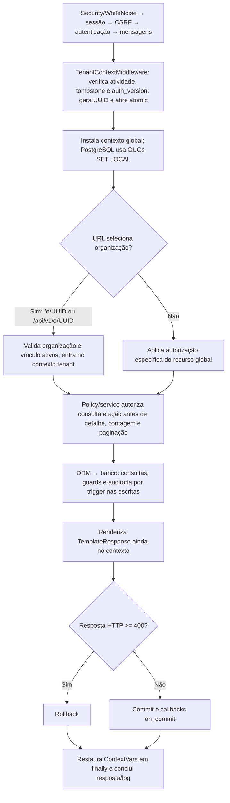
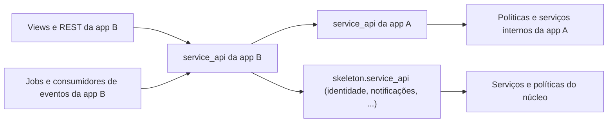

# Arquitetura

O skeleton separa três decisões que costumam se misturar em aplicações web: **quem é a pessoa**, **a qual organização pertencem os dados** e **qual operação ela pode executar**. O núcleo fornece essa fundação; as regras de negócio pertencem ao projeto derivado. Consulte o [guia dos conceitos](concepts.md) para o vocabulário usado aqui.

## Três planos de dados

| Plano | O que guarda | Como é protegido |
|---|---|---|
| Identidade e controle global | `User`, `UserProfile`, `Organization`, catálogo e controle de releases | Superfícies explícitas validam o ator; não há RLS de tenant nessas tabelas |
| Dados organizacionais | Vínculos, papéis, grupos, convites, parâmetros de apps e negócio derivado | Organização obrigatória, políticas de acesso no Django e RLS no PostgreSQL |
| Tabelas técnicas dos frameworks | Migrations, sessões, content types, permissões Django e tabelas do allauth | Ciclo de vida oficial dos frameworks, privilégios explícitos e exceção nominal no catálogo |

A **configuração da instância** (banco, email, hosts, armazenamento e segredos) vive fora desses planos, em um SQLite próprio (`skeleton/instance/`, padrão `var/instance/instance.sqlite3`) lido antes de o Django inicializar, usando apenas o módulo `sqlite3` da biblioteca padrão. Ele guarda somente configuração e o estado do setup inicial — nunca dados da aplicação —, não entra em `DATABASES` nem tem migrations. As chaves aceitas são fixadas em código (`skeleton/instance/schema.py`) e os segredos são cifrados com Fernet usando uma chave mestra separada, rotacionável em dois passos via `manage.py instance rotate-key` sem interromper leituras. A precedência é **ambiente > SQLite > padrão**, consultável com `manage.py instance show`.

Essa separação não é apenas organizacional: identidades globais nunca são duplicadas por organização, e tabelas técnicas nunca entram no gateway genérico de negócio.

## Onde cada responsabilidade fica

| Diretório | Responsabilidade | Limite principal |
|---|---|---|
| `skeleton/common` | Bases abstratas, querysets, erros, logging, operações de migration, estado do contexto corrente (`skeleton/common/context.py`: `Context`, `current_context`, `is_tenant_model`; gerenciadores de contexto ficam em `skeleton.tenancy.context`), regras puras de DNS e nomes reservados (`skeleton/common/hostnames.py`) e validação das páginas em blocos (`skeleton/common/page_blocks.py`; [páginas em blocos](ui-design.md#páginas-em-blocos)) | Não conhece regras de negócio do derivado nem importa outros pacotes `skeleton.*` |
| `skeleton/accounts` | Contas, perfis, integração allauth, provedores de identidade no banco (OIDC, SAML e LDAP), papéis limitados de plataforma e o núcleo como provedor OIDC de clientes nativos (`skeleton/accounts/idp/`: registro `NativeClient`, política PKCE/loopback sobre `allauth.idp.oidc` e dispositivos conectados) | Não reimplementa OAuth, OIDC, SAML, MFA ou redefinição de senha; `SocialApp` é montado em memória; LDAP passa apenas por `skeleton/accounts/ldap/client.py` com TLS verificado |
| `skeleton/tenancy` | Organizações (`skeleton/tenancy/services.py`), vínculos, convites, contexto transacional e ingresso (política de admissão, pedidos, links, domínios verificados e regras de SSO); endereços de organização (`skeleton/tenancy/site.py`, conversor de rota `org` em `skeleton/tenancy/routing.py`, onde toda rota web de organização começa com `ORG`); páginas configuráveis da organização (`skeleton/tenancy/pages.py`) e espelho global da página pública (`sync_site_page`) | Tenant sempre validado pelo servidor, nunca por corpo ou cabeçalho; quem pede ingresso entra via `system_context` com motivo `join:*` aberto pelo serviço; índices lidos antes do tenant são `SystemRecord` globais |
| `skeleton/access` | Papéis, grupos, permissões, policies e serviços de gestão; leitura e designação de administradores pela plataforma (`skeleton/access/administration.py`); autorização de tabelas derivadas pelo registro pai (`skeleton/access/derivation.py`) | Permissões globais do Django não substituem a autorização organizacional |
| `skeleton/system` | Registro de especificações, catálogo, gestão de apps (disponibilidade e ativação), checks e controle de releases. Empacotamento em `skeleton/system/packaging/` (fachada pública em `skeleton.system.packages`; pacote de release em `release.py`). Atualizações de clientes nativos em `skeleton/system/native_clients/` (verificação Ed25519, sincronização do GitHub e entrega anônima). Quadros do painel da organização em `skeleton/system/dashboard_widgets.py` (renderizados por `skeleton/web/widgets.py`) | Metadados não executam DDL; o estado das apps é memoizado apenas durante a requisição |
| `skeleton/audit` | Eventos e infraestrutura de auditoria | Triggers no PostgreSQL são a única fonte; não existe auditoria paralela por signals |
| `skeleton/jobs` | Fila de jobs no banco com tipos registrados em código | Enfileiramento na transação do negócio; payload apenas com identificadores, sem dados de negócio ([jobs](jobs.md)) |
| `skeleton/notifications` | Tipos de notificação por contexto (plataforma, organização e app), `notify()`, caixa por pessoa com texto renderizado no envio, configurações de instância e organização, alertas e comunicados da plataforma | Snapshot e marcadores aceitam apenas campos declarados e não sensíveis; texto usa gramática fechada, sem template ([notificações](notifications.md)) |
| `skeleton/events` | Eventos de domínio publicados explicitamente pelos serviços | Publicados na mesma transação da escrita, apenas com campos declarados e não sensíveis; auditoria segue como fonte de verdade ([eventos](events.md)) |
| `skeleton/integrations` | Webhooks da organização (endpoints, entrega assinada, retentativas e log) e tokens de API | Saídas HTTP passam apenas pelo cliente anti-SSRF; entregas agem como a conta de serviço do endpoint ([webhooks](webhooks.md)); o banco guarda só o hash dos tokens ([API](api.md#tokens-de-api)); tokens OIDC de clientes nativos passam pelo mesmo middleware ([API](api.md#access-tokens-oidc-de-clientes-nativos)) |
| `skeleton/files` | Anexos em armazenamento privado, cota por organização e verificação por antivírus | Sem URL pública; download ocorre apenas por view autorizada ([arquivos](files.md)) |
| `skeleton/sequences` | Sequências numéricas sem lacunas por organização e período | Contador bloqueado na transação do chamador ([sequências](sequences.md)) |
| `skeleton/transfer` | Exportação e importação CSV de tabelas expostas via job | Passa somente pelo gateway autorizado; arquivo privado restrito a quem solicitou, com retenção declarada ([exportação e importação](data-transfer.md)) |
| `skeleton/flows` | Motor de fluxos de processo: definições versionadas declaradas pelas apps, instâncias, tarefas, formulários e aprovações | Apenas o motor; regras de negócio pertencem às apps e condições são árvores de dados ou callables registrados, nunca `eval` ([fluxos](flows.md)) |
| `skeleton/comments` | Comentários em registros, moderação e integração com a linha do tempo | Autorização derivada do registro alvo, habilitada por `CommentPolicy`; texto simples sempre escapado ([comentários](comments.md)) |
| `skeleton/insights` | Indicadores de gestão da instância (label `sk_insights`): resumo por organização e métricas diárias | Tabelas operacionais globais escritas somente pelos jobs `insights.*`, fora do gateway; lê outros pacotes por funções públicas ([API de gestão](platform-api.md)) |
| `skeleton/billing` | Cobrança SaaS da plataforma (label `sk_billing`): catálogo global de produtos e preços, conta de cobrança, assinaturas, faturas e pagamentos | Núcleo é a fonte de verdade e o provedor apenas processa pagamentos; valores em inteiros, termos de preço e linhas de fatura imutáveis; desligado por padrão ([cobrança](billing.md)) |
| `skeleton/appearance` | Marca e temas da instância (label `sk_appearance`): `InstanceBrand`, `InstanceTheme`, geração de CSS (`themes.py`), validação de CSS personalizado (`css_validation.py`), imagens em `platform/branding/` (`images.py`), cache por processo (`snapshot.py`), página inicial pública (`InstancePage` e `pages.py`) e job `appearance.orphans` | Apenas dados, regras puras e serviços escritos pelo administrador da plataforma com CAS; páginas e rotas `/brand/` ficam em `skeleton/web`; marca da organização prevalece; CSS personalizado só é servido como `text/css`, nunca embutido no HTML ([aparência](appearance.md)) |
| `skeleton/setup` | Assistente de configuração inicial antes de existir banco configurado | A credencial owner existe apenas na requisição que executa as migrations |
| `skeleton/observability` | Métricas Prometheus, tracing OpenTelemetry e Sentry, todos opt-in | Nenhum rótulo ou span carrega dado pessoal, identificador de registro ou segredo; eventos de erro levam apenas campos estruturados permitidos ([deployment](deployment.md#observabilidade-87)) |
| `skeleton/instance` | Configuração da instância em SQLite próprio com segredos cifrados | Lido antes do Django, sem `DATABASES` nem migrations; nunca guarda dados da aplicação |
| `skeleton/records` | Gateway genérico de registros: coerção por allowlist, criação, edição, exclusão, restauração, seletor de referências, busca global em tabelas com `TableSpec.global_search` e recursos de acesso | Python puro, sem modelos nem label; acima de `access`/`system` e abaixo das superfícies; opera sempre via `authorized_queryset` e `require_record_action` |
| `skeleton/web` e `skeleton/api` | Superfícies HTML e REST, incluindo o painel de apps da organização (`skeleton/web/applications.py`, `skeleton/api/applications.py`) e o roteamento de URLs declaradas pelas apps (`skeleton/web/app_routing.py`) | Compartilham `skeleton.records` e os serviços, não importam uma à outra (exceto a sonda de saúde) e revalidam autorização no servidor; `skeleton/system` não importa nenhuma das duas |
| `skeleton/service_api` | API de serviços pública do núcleo e contrato entre apps: `ServiceAPI`, `@service_method`, `@deprecated`, `Page`/`paginate`, erros públicos, introspecção (`contract`), registro de APIs (`registry`) e serviços do [catálogo do núcleo](service-api.md#catálogo-do-núcleo), incluindo busca global (`search`) | Única porta do núcleo para apps; não abre contexto (exige que `actor` coincida com o contexto e que haja tenant) e retorna somente DTOs imutáveis |
| `skeleton/testing` | Kit de testes distribuído no wheel (`assert_service_contract`, cenários A/B, helpers de isolamento, default deny, app desativada e CAS) e o projeto hospedeiro `skeleton.testing.host` para apps em repositório próprio | Exclusivo para testes; provisionamento usa serviços públicos, fixtures usam `system_context` e nenhum serviço sob teste roda nesse contexto |
| `skeleton/conf` | Settings padrão, perfis e URLs distribuídos com o núcleo; `dev_apps.py` carrega apps de checkout local via `SKELETON_DEV_APPS` | Não importa regras ou configurações do projeto derivado; `SKELETON_DEV_APPS` só funciona em dev e testes |
| `skeleton/contrib` | Apps first-party entregues no wheel do núcleo (`kind: "bundled_app"` ou `"bundled_library"`, label `skeleton_*` e versão idêntica à do core); agenda e livro contábil são bibliotecas | Carregadas apenas pelo mapa fixo em `skeleton/conf/bundled.py` (automaticamente quando uma app depende da biblioteca ou por `SKELETON_BUNDLED_APPS`); bibliotecas não têm disponibilidade nem ativação próprias; o restante do núcleo nunca importa `skeleton.contrib` |
| `config` | Overlay de settings, URLs e entrypoints do projeto derivado | Mantém os pontos de extensão sem renomear labels do núcleo |
| `applications` | Apps de negócio do projeto derivado | Consome apenas contratos públicos do núcleo |
| `examples/notes` | Exemplo didático opcional | Não é dependência do núcleo |
| `deployment_agent` | Processo operacional separado que prepara e troca releases (`paths.py`, `environments.py`, `selfupdate.py`, `github.py` e `sources.py`; ver [guia de atualização](updates.md)) | Credenciais owner e comandos privilegiados nunca pertencem ao processo web |

Por **overlay** entendem-se os arquivos de configuração do projeto derivado aplicados sobre os defaults do núcleo; atualizar o wheel do núcleo nunca substitui esses arquivos.

### Direção das dependências entre pacotes

Os pacotes do núcleo organizam-se em camadas: `skeleton/common` na base, o domínio (`accounts`, `tenancy`, `access`, `system`, `audit`) acima dele, os subsistemas e a `service_api` no meio e as superfícies (`web` e `api`) no topo. O teste `tests/unit/test_core_layering.py` verifica via AST (ignorando migrations e blocos `if TYPE_CHECKING:`) cinco regras:

- **R1:** `common` não importa nenhum outro pacote `skeleton.*`.
- **R2:** `accounts`, `tenancy`, `access`, `system` e `audit` não importam `web`, `api`, `service_api` nem `contrib`.
- **R3:** `web` e `api` não importam uma à outra.
- **R4:** `service_api` não importa `web` nem `api`.
- **R5:** nos demais subsistemas (`jobs`, `events`, `notifications`, `files`, `integrations`, `sequences`, `observability`, `instance`, `flows`, `comments`, `transfer`, `appearance` e afins), apenas arquivos cujo nome contém `views` ou `urls` podem importar `web` ou `api`. `setup`, `conf`, `contrib` e `testing` ficam fora dessa regra.

Os cinco pacotes de domínio ainda se referenciam entre si. Exceções históricas registradas em `KNOWN_EXCEPTIONS` (em `tests/unit/test_core_layering.py`) só podem diminuir: qualquer inversão nova falha o teste, assim como manter uma exceção já resolvida.

## Modelos e identidades estáveis

`SystemRecord`, `OrganizationRecord` e `SecuredRecord` são bases abstratas: cada subclasse gera sua própria tabela física, sem supertabela nem join universal. Para criar um modelo, escolha a base em [modelo de dados](data-model.md), registre o `TableSpec` e instale a infraestrutura na migration.

Cada identificador tem um papel fixo: `sysid` identifica a linha, o código comercial atende o domínio e `table_key` identifica o modelo registrado na interface. Nenhum deles concede acesso nem serve como nome SQL livre vindo do cliente.

Os labels estáveis do núcleo são `sk_accounts`, `sk_tenancy`, `sk_access`, `sk_system`, `sk_audit`, `sk_jobs`, `sk_events`, `sk_notifications`, `sk_files`, `sk_integrations`, `sk_sequences`, `sk_flows`, `sk_comments`, `sk_billing`, `sk_appearance`, `sk_transfer`, `sk_insights`, `sk_observability` (sem modelos) e `sk_instance` (apenas o comando `instance`, sem modelos); o exemplo usa `example_notes`. `AUTH_USER_MODEL='sk_accounts.User'` precisa existir antes da primeira migration. Renomear qualquer label depois que há histórico exige migração estrutural e de dados.

## Caminho de uma requisição

**Host de organização.** Logo após o `XFrameOptionsMiddleware` e antes da sessão, o `OrganizationSiteMiddleware` (`skeleton/tenancy/site_middleware.py`) classifica o host validado por `ALLOWED_HOSTS` (`classify_host`). No host da plataforma nada muda. Em um host `<slug>.<domínio base>` ou domínio próprio comprovado (`skeleton/tenancy/site_domains.py`, aceito via `SiteAllowedHosts`), ele consulta `OrganizationSite` (`find_site`), ativa o escopo de site (`site_scope`) e ajusta o roteamento:

- Requisições `GET` em `/o/<uuid do site>/…` redirecionam para a URL limpa.
- URLs limpas de rotas organizacionais têm `request.path_info` reescrito internamente para `/o/<uuid>/…`, mantendo `request.path` limpo para templates e `?next=`, sem exigir alterações em quem lê `path_info`.
- **Rotas da organização sempre prevalecem** sobre rotas globais de mesmo caminho (`/`, `/notifications/`, `/flows/tasks/`).
- Rotas globais passam apenas por lista explícita; host desconhecido, desligado, reservado, outra organização ou rota fora da lista recebem o mesmo `404` neutro.

A sequência completa nesse host é: `SecurityMiddleware` → … → `XFrameOptionsMiddleware` → `OrganizationSiteMiddleware` → `SiteSessionMiddleware` (cookie com `Domain=.<domínio base>`) → CSRF → autenticação → `TenantContextMiddleware` (valida o vínculo e bloqueia qualquer organização diferente do escopo) → view → resposta. Veja [endereços de organização](organization-sites.md).

Depois do middleware de contexto vêm o `AccountMiddleware` (allauth), o `skeleton.common.locale.LocaleMiddleware` (que ativa idioma e fuso dentro do contexto de tenant para ler as preferências da organização sob RLS), o `ColorSchemeMiddleware` e o `skeleton.accounts.mfa_middleware.MFAEnrollmentMiddleware` (que redireciona para o cadastro de MFA sempre que uma regra exigir 2FA ainda pendente — [quem cadastra o MFA](authentication-sso.md#mfa-cifrado-e-obrigatório)).

`ATOMIC_REQUESTS` permanece `False` porque o contexto controla a transação explicitamente. Páginas HTML e endpoints REST chamam os mesmos serviços (incluindo gestão de acesso por `skeleton.access.resources`); esconder menus ou campos é apenas conveniência visual, nunca controle de segurança.

Evite respostas em streaming que executem consultas depois que o contexto se encerra. O runtime padrão é WSGI/Gunicorn síncrono; o entrypoint ASGI não garante segurança transacional do ORM em views assíncronas. Jobs abrem seu próprio contexto por organização, e callbacks `on_commit` recebem dados prontos ou abrem um novo contexto.

## Persistência e evolução do banco

Toda gravação verifica se a revisão enviada coincide com a revisão atual antes de incrementar `revision` (CAS), impedindo que edições simultâneas se sobrescrevam. Os metadados de autoria vêm do contexto, os querysets restringem operações em lote e aplicam exclusão lógica, e triggers/guards instalados por migration protegem inclusive acessos fora do Python — confirmando cada evento de auditoria na mesma transação da mudança.

A infraestrutura de cada tabela própria usa uma especificação **congelada na migration**, permitindo recriar bancos históricos mesmo após alterações futuras nos modelos. `AppConfig.ready()` apenas registra metadados e checks, sem consultar o schema nem executar DDL.

### Como ler as dependências iniciais

As migrations iniciais obedecem a esta ordem de dependência:

- `accounts.0001` precede `tenancy.0001`; `system.0001` cria o catálogo.
- `access.0001` depende de `tenancy` e `system`; `tenancy.0002` acrescenta convites.
- `audit.0001` cria a tabela de eventos sem FKs; `audit.0002` instala a infraestrutura inicial sobre o conjunto.
- `example_notes.0001` depende de `audit.0002` e instala a infraestrutura da tabela de exemplo.
- `sk_system.0002_technical_privileges` depende das migrations finais das bibliotecas fixadas e concede ao runtime PostgreSQL apenas os privilégios técnicos necessários.

Nunca exponha tráfego com o schema parcialmente protegido. Após rodar migrations, sincronize o catálogo e execute `check_skeleton_schema` com a credencial runtime ([catálogo](table-catalog.md)).

## Duas descrições da mesma instalação, com funções diferentes

O **registry** mantém as `TableSpec` em código (modelos, allowlists de campos, sensibilidade e exposição). O **catálogo** é o inventário físico no banco, cobrindo inclusive tabelas técnicas e desconhecidas. Alterar rótulos ou descrições no catálogo não abre API, não cria tabela e não muda políticas de acesso.

Cada app tem um `manifest.json` canônico carregado como `AppManifest`, independente das `TableSpec`. Suas rotas e menus entram sob prefixos reservados da organização, antes do gateway, e tanto a navegação quanto as policies revalidam ativação e permissão.

A comunicação entre apps — e das apps com o núcleo — acontece somente pela **API de serviços**: cada app publica classes em `service_api.py`, e outras apps importam exclusivamente esse módulo. As chamadas executam no contexto e na transação de quem chama, revalidam autorização internamente e devolvem DTOs imutáveis. As views HTML e REST (inclusive as do núcleo, como perfil, organizações, painel, auditoria e configuração de apps) são camadas finas sobre esses serviços, com mapeamento único de erros para HTTP.

No CI e no empacotamento, `E018` valida `runtime.service_api`, `E019` bloqueia imports internos de outra app ou de dependências não declaradas, `W019` sinaliza módulos não públicos do núcleo e `package doctor` repete essa análise antes do build ([API de serviços entre apps](service-api.md)).

Separe sempre os dois níveis de estado: `AppInstallation` representa ativação e parâmetros **de uma organização**; `ComponentInstallation` e `DeploymentOperation` representam instalação e operações **da plataforma**. Misturar os dois permitiria a um administrador organizacional alterar software compartilhado.

## O web solicita; o agente executa

O núcleo é distribuído como o wheel `django-skeleton`, enquanto `config` e `applications` ficam no projeto derivado. No startup, o inventário privado indica quais apps gerenciadas devem ser carregadas; apps locais continuam em `PROJECT_APPS`. Retirar uma app gerenciada preserva seu schema e suas migrations históricas sem carregar seus modelos nem rotas.

A administração da plataforma fica em `/platform/`, com views explícitas (`skeleton/web/platform`) sobre os serviços de lifecycle. O Django admin não tem site nem rotas: `django.contrib.admin` permanece instalado apenas via `SimpleAdminConfig` como dependência técnica para `LogEntry` e migrations históricas, e `/admin/…` responde `404`. Os dados de negócio ficam no viewer de `/o/<org>/catalog/` e `/o/<org>/tables/<table_key>/`. O manifesto v2 carrega a apresentação de forma imutável em memória, mas `TableSpec` e os serviços continuam sendo a autoridade de segurança.

Em `/platform/updates/`, o processo web valida o administrador e envia a solicitação ao agente independente. O agente mantém seu journal privado, verifica assinatura e conteúdo, monta o novo release em diretório isolado, faz backup, executa migrations e checks e reinicia os serviços — preparando a prévia em segundo plano para não bloquear workers nem transações web. O processo web nunca executa `pip` ou DDL nem acessa a credencial owner.

Todo deployment operacional roda o agente. Em containers, ele roda em um serviço próprio (o único com a credencial owner): `deployment_agent/bootstrap.py` instala o release inicial e `deployment_agent/launcher.py` (somente biblioteca padrão) executa o release ativo nos serviços `web`, `worker` e `scheduler`, obedecendo aos pedidos de parada e reinício gravados no volume de controle — sem montar o socket Docker. Com systemd, o agente usa hooks do `systemctl`. Somente releases publicados e assinados são instalados, um passo e uma confirmação por vez.

Se uma resposta HTTP se perder durante a entrega ao agente, o reenvio explícito preserva a aprovação original em vez de criar outra operação; apenas o estado consolidado no journal confirma o resultado ([provisionamento e recuperação](deployment.md#agente-independente-de-deployment)).

## Topologia em alta disponibilidade

Para escalar, a instância opera com múltiplos nós de aplicação atrás de um balanceador e com PostgreSQL e Redis dedicados em um servidor de dados separado (um cluster por instância). Os nós são sem estado: compartilham a mesma configuração via ambiente (modo cluster), guardam anexos em S3 ou volume compartilhado e mantêm sessões, jobs e coordenação dos agentes no PostgreSQL. Um agente primário — eleito por trava no PostgreSQL — executa migrations e coordena a atualização; os seguidores atualizam o release em seus respectivos nós ([alta disponibilidade](high-availability.md)).

## Segurança: o que a arquitetura não promete

- **PostgreSQL:** a role runtime não é owner, superuser nem `BYPASSRLS`; owner offline e gravador de auditoria são separados. A RLS com `FORCE` protege contra filtros tenant esquecidos, mas não contra uma credencial runtime comprometida capaz de executar `set_config` ou SQL arbitrário.
- **Django:** papéis, visibilidade e exclusão lógica não são aplicados pela RLS. Mesmo um superusuário Django precisa de vínculo e autorização nas rotas organizacionais.
- **Auditoria:** append-only para o runtime, não WORM contra DBA ou owner de migrations.
- **Redis:** coordena o rate limiting distribuído em produção (login do allauth e tokens de API por token e por falhas de IP); LocMem não coordena múltiplos workers (`skeleton.W029`). Se o cache ficar indisponível, os limites de token deixam passar — funcionam como freio de abuso, não como autorização. O uso dos tokens é registrado operacionalmente em `ApiTokenActivity`, sem auditoria por linha.
- **HTTP:** usa sessão Django e CSRF nas páginas e na API; tokens Bearer opacos funcionam apenas em `/api/v1/`, sem JWT, BasicAuth, CORS aberto ou cookie wildcard. Toda resposta envia uma `Content-Security-Policy` de mesma origem ([deployment](deployment.md#content-security-policy)): scripts somente de arquivos locais, sem `object` e sem enquadramento — camada adicional ao autoescape, não substituta. Páginas HTML autenticadas saem com `Cache-Control: no-store, private` para não ficarem no histórico após o logout.
- **Tokens de API:** o token é um segredo ao portador; quem o obtém age como o dono dentro dos escopos até expirar ou ser revogado. Por isso, a validade é obrigatória e limitada, a emissão exige sessão (e MFA quando aplicável), há teto de tokens ativos por dono (`SKELETON_API_TOKEN_MAX_PER_OWNER`) e o valor completo aparece uma única vez (o banco armazena apenas o SHA-256 de um segredo de 256 bits). Enviar sessão e token juntos retorna `400`. Escopos são aplicados centralmente (`has_table_permission` e `require_credential_scope`) e apenas restringem o papel da pessoa: tokens nunca concedem capacidade administrativa, papel de plataforma nem acesso a views sem `token_methods`. Um token restrito a uma organização retorna `404` em outra. Revogação, desativação e mudança de `auth_version` valem imediatamente na requisição seguinte.
- **Saídas HTTP:** toda chamada do núcleo para URLs fornecidas por terceiros (como webhooks e push) passa por `skeleton.common.outbound_http`, sobre `http.client`/`ssl` da biblioteca padrão. Aceita somente HTTPS nas portas de `SKELETON_OUTBOUND_HTTP_PORTS` (padrão `443`), sem credenciais na URL. O DNS é resolvido uma única vez e recusado se qualquer IP não for público (bloqueando faixas privadas, loopback, link-local, CGNAT, reservadas, multicast, não especificadas, IPv4 mapeado em IPv6, NAT64 e 6to4/Teredo). A conexão vai direto ao IP validado com SNI, validação de certificado e cabeçalho `Host` originais, bloqueando DNS rebinding. Não segue redirecionamentos, ignora proxies do ambiente, aplica timeouts de 5 s para DNS, 5 s para conexão, 10 s por leitura e 20 s no total (até 30 s se o destino ficar mudo) e lê no máximo 64 KB da resposta. O contexto TLS é inicializado uma vez por processo. `SKELETON_OUTBOUND_HTTP_DEVELOPMENT_OVERRIDE` libera `http://` e IPs privados apenas com `DEBUG=True`. Nunca use `requests` ou `urllib` para esses destinos. Proxies de saída corporativos ainda não têm suporte nativo ([webhooks](webhooks.md)).

Veja [controle de acesso](access-control.md) para o detalhamento das decisões, [deployment](deployment.md) para preservar essas fronteiras em produção e [testes](testing.md) para distinguir contratos de provas executadas.
