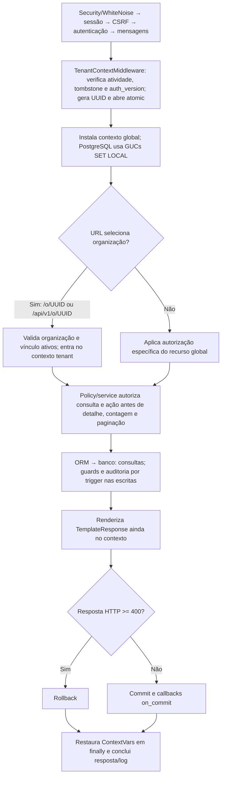

# Arquitetura

O skeleton separa três responsabilidades que costumam se confundir: **quem é a pessoa**, **a qual organização pertencem os dados** e **qual operação é permitida**. O núcleo fornece esses contratos e sua infraestrutura; a app derivada fornece o negócio. O [guia dos conceitos](concepts.md) explica os termos usados aqui.

## Três planos de dados

| Plano | O que pertence a ele | Como é protegido |
|---|---|---|
| Identidade e controle global | `User`, `UserProfile`, `Organization`, catálogo e controle de releases | Superfícies específicas validam o ator; não há RLS tenant nessas tabelas |
| Dados organizacionais | Vínculos, papéis/grupos, convites, configuração de apps e negócio derivado | Organização obrigatória, autorização Django e RLS tenant no PostgreSQL |
| Técnico dos frameworks | Migrations, sessões, content types, permissões Django e tabelas allauth | Schema/lifecycle oficiais, privilégios explícitos e exceção nominal no catálogo |

Uma organização não duplica identidades globais. As tabelas técnicas também não viram entidades de negócio nem entram no gateway genérico. A separação define quem pode consultar e alterar cada recurso: não é apenas uma organização de diretórios.

## Onde cada responsabilidade fica

| Diretório | Responsabilidade | Limite importante |
|---|---|---|
| `skeleton/common` | Bases abstratas, querysets, erros, logs e instalação de infraestrutura por migrations | Não conhece regras de negócio do derivado |
| `skeleton/accounts` | Conta/perfil e integração allauth | Não reimplementa OAuth, OIDC, SAML, MFA ou reset de senha |
| `skeleton/tenancy` | Organização, vínculo, convite e contexto transacional | Seleção de tenant validada, nunca flags escolhidas pelo body/header |
| `skeleton/access` | Papéis, grupos, permissões, policies e serviços de gestão | Permissões Django globais não substituem autorização empresarial |
| `skeleton/system` | Registro de especificações, catálogo, apps, checks e controle de releases | Metadados não executam DDL |
| `skeleton/audit` | Eventos e infraestrutura de auditoria | Triggers são a fonte; não há segunda fonte por signals de save |
| `skeleton/web` e `skeleton/api` | Páginas e endpoints | Compartilham serviços e revalidam autorização no servidor |
| `skeleton/conf` | Defaults, profiles e URLs distribuídos com o núcleo | Não importa negócio nem configurações do derivado |
| `config` | Overlay de settings, URLs e entrypoints do projeto | Mantém os hooks de extensão sem renomear labels do núcleo |
| `applications` | Apps de negócio do projeto derivado | Consome contratos do núcleo; não modifica suas regras |
| `examples/notes` | Exemplo didático opt-in | Não é dependência do núcleo |
| `deployment_agent` | Processo operacional separado para preparar e trocar releases | Credenciais/comandos privilegiados não pertencem ao web |

“Overlay” significa os arquivos de configuração pertencentes ao projeto derivado, sobre os defaults do core. Atualizar o wheel do núcleo não deve substituir esses arquivos.

## Modelos e identidades estáveis

`SystemRecord`, `OrganizationRecord` e `SecuredRecord` são bases abstratas. Seus campos existem em cada tabela filha concreta; não há supertabela universal nem join universal. Escolha a base no [modelo de dados](data-model.md), registre a especificação e instale a infraestrutura na migration.

`sysid` identifica uma linha; código comercial identifica algo segundo o negócio; `table_key` identifica um modelo registrado na interface. Nenhum desses valores é autorização ou um nome SQL livre recebido do cliente.

Os labels estáveis do núcleo são `sk_accounts`, `sk_tenancy`, `sk_access`, `sk_system` e `sk_audit`; o exemplo usa `example_notes`. `AUTH_USER_MODEL='sk_accounts.User'` é definido antes de qualquer migration. Renomear esses identificadores depois de existir histórico exige uma migração de dados/estrutura, não uma troca cosmética de configuração.

## Caminho de uma requisição

`AccountMiddleware` do allauth vem depois do middleware de contexto. `ATOMIC_REQUESTS=False`: o contexto controla a transação explicitamente. Forms e API chamam os mesmos serviços; menus e campos ocultos são conveniência de interface, não barreiras de segurança.

Não use streaming que dependa de consultas tenant depois do encerramento desse contexto. O runtime inicial é WSGI/Gunicorn síncrono; o entrypoint ASGI não promete transações ORM seguras em views async. Jobs abrem seu próprio contexto por organização, e callbacks `on_commit` recebem valores prontos ou abrem um novo contexto.

## Persistência e evolução do banco

Cada gravação compara a revisão lida com a atual e incrementa `revision` somente se vencer: é o CAS que impede sobrescrita de edição concorrente. Os metadados recebem o ator do contexto. Querysets restringem operações em lote e usam exclusão lógica. Guards e triggers instalados por migration protegem caminhos fora do Python; um evento corresponde a uma mudança efetiva e é confirmado junto com ela.

A infraestrutura de uma tabela própria usa uma especificação **congelada na migration**. Isso permite reconstruir o banco antigo mesmo que modelos e catálogo atuais tenham mudado. `AppConfig.ready()` registra metadados e checks; não consulta o schema nem executa DDL.

### Como ler as dependências iniciais

Uma migration depende de outras quando precisa de suas tabelas ou infraestrutura. O grafo inicial segue esta ordem:

- `accounts.0001` precede `tenancy.0001`; `system.0001` cria o catálogo.
- `access.0001` depende de tenancy/system; `tenancy.0002` acrescenta convites.
- `audit.0001` cria o evento sem FKs; `audit.0002` depende do conjunto e instala a infraestrutura inicial.
- `example_notes.0001` depende de `audit.0002` e instala a infraestrutura da tabela de exemplo.
- `sk_system.0002_technical_privileges` depende das migrations finais das bibliotecas fixadas e concede somente o inventário técnico autorizado ao runtime PostgreSQL.

Não sirva requests com schema parcialmente protegido. Depois de migrations, sincronize o catálogo e execute o schema check com a credencial runtime. O [catálogo](table-catalog.md) explica o que ele verifica.

## Duas descrições da mesma instalação, com funções diferentes

O **registry** contém `TableSpec` no código: modelos, campos permitidos, sensibilidade e exposição. O **catálogo** é um inventário físico sincronizado, inclusive de tabelas técnicas e desconhecidas. Alterar título/descrição no catálogo não abre API, cria tabela ou muda policy.

Uma app possui `manifest.json` canônico, carregado como `AppManifest`, separado das especificações de tabela. Rotas e menus declarados entram sob prefixes tenant reservados, antes do gateway. A navegação e as policies revalidam ativação e permissão: esconder um menu não basta.

`AppInstallation` guarda ativação/configuração **da organização**. `ComponentInstallation` e `DeploymentOperation` representam instalação e operação **da plataforma**. Confundir essas entidades permitiria a um admin tenant alterar software usado por todos.

## O web solicita; o agente executa

O core é o wheel `django-skeleton`; `config` e `applications` pertencem ao derivado. O inventário privado determina as apps gerenciadas no startup; apps locais continuam em `PROJECT_APPS`. Retirar uma app gerenciada conserva schema e migrations históricas sem carregar seus modelos/rotas de negócio.

O admin padrão, com autodiscover Django, é a única instância segura de plataforma. `/admin/system/releases/` valida o ator e solicita uma operação ao agente independente. O agente guarda um journal privado, valida assinatura/conteúdo, prepara release separado, faz backup, migrations, checks runtime e reinício. A request web nunca executa pip/DDL nem recebe a credencial owner.

Uma resposta de entrega perdida não autoriza refazer o plano como uma nova operação. O reenvio explícito conserva o vínculo da aprovação original; a nova tentativa de HTTP continua auditada com seu próprio ID. Só um status coerente do journal confirma o resultado. Veja [provisionamento e recuperação](deployment.md#agente-independente-de-deployment).

## Segurança: o que a arquitetura não promete

- **PostgreSQL:** runtime não é owner/superuser/BYPASSRLS. Owner offline e audit writer são separados. RLS/FORCE protege filtros tenant esquecidos, não uma credencial runtime maliciosa capaz de `set_config` ou SQL injection arbitrária.
- **Django:** papéis, visibilidade e exclusão lógica não são implementados pela RLS. Superuser Django não pula os requisitos nas rotas tenant.
- **SQLite:** serviços, triggers e integridade existem; RLS e segurança contra quem lê/altera o arquivo não existem.
- **Auditoria:** append-only no runtime, não WORM contra DBA/migration owner.
- **Redis:** coordena rate limiting distribuído em produção; LocMem não coordena vários workers.
- **HTTP:** sessão Django e CSRF; sem JWT da API, BasicAuth, CORS aberto ou domínio de cookie wildcard.

[Controle de acesso](access-control.md) detalha as decisões. [Deployment](deployment.md) mostra como preservar essas fronteiras na operação. [Testes](testing.md) distingue contratos implementados de provas realmente executadas.
