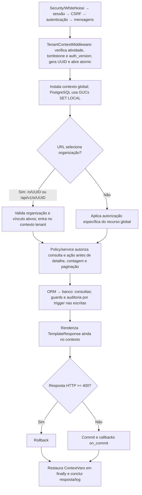
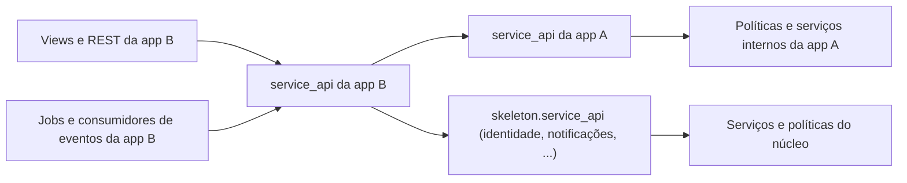

# Arquitetura

O skeleton separa três responsabilidades que costumam se confundir: **quem é a pessoa**, **a qual organização pertencem os dados** e **qual operação é permitida**. O núcleo fornece esses contratos e sua infraestrutura; a app derivada fornece o negócio. O [guia dos conceitos](concepts.md) explica os termos usados aqui.

## Três planos de dados

| Plano | O que pertence a ele | Como é protegido |
|---|---|---|
| Identidade e controle global | `User`, `UserProfile`, `Organization`, catálogo e controle de releases | Superfícies específicas validam o ator; não há RLS tenant nessas tabelas |
| Dados organizacionais | Vínculos, papéis/grupos, convites, configuração de apps e negócio derivado | Organização obrigatória, autorização Django e RLS tenant no PostgreSQL |
| Técnico dos frameworks | Migrations, sessões, content types, permissões Django e tabelas allauth | Schema/lifecycle oficiais, privilégios explícitos e exceção nominal no catálogo |

A **configuração da instância** (banco, email, hosts, segredos, armazenamento) fica fora desses planos: num SQLite próprio (`skeleton/instance/`, padrão `var/instance/instance.sqlite3`), lido pelos settings antes de o Django existir, com `sqlite3` da biblioteca padrão. Ele guarda só configuração e o estado do setup, nunca dados de aplicação, não é um alias de `DATABASES` e não tem migrations Django. O catálogo de chaves é fechado e fica em código (`skeleton/instance/schema.py`); os segredos são tokens Fernet cuja chave mestra fica num arquivo separado. A precedência é ambiente > SQLite > default, e `manage.py instance show` mostra a origem de cada chave.

Uma organização não duplica identidades globais. As tabelas técnicas também não viram entidades de negócio nem entram no gateway genérico. A separação define quem pode consultar e alterar cada recurso: não é apenas uma organização de diretórios.

## Onde cada responsabilidade fica

| Diretório | Responsabilidade | Limite importante |
|---|---|---|
| `skeleton/common` | Bases abstratas, querysets, erros, logs e instalação de infraestrutura por migrations | Não conhece regras de negócio do derivado |
| `skeleton/accounts` | Conta/perfil, integração allauth, provedores de identidade no banco (OIDC, SAML e LDAP, #29–#33) e papéis limitados de plataforma (#34) | Não reimplementa OAuth, OIDC, SAML, MFA ou reset de senha; o `SocialApp` é montado em memória; LDAP só por `skeleton/accounts/ldap/client.py`, com TLS verificado |
| `skeleton/tenancy` | Organização, vínculo, convite, contexto transacional e ingresso: política de admissão, pedidos, links, domínios verificados e regras de SSO da organização (#26–#28, #31) | Seleção de tenant validada, nunca flags escolhidas pelo body/header; quem pede ingresso não tem tenant e só entra por `system_context` com razão `join:*` aberta pelo serviço; índices lidos antes do tenant (diretório, posse de domínio) são `SystemRecord` globais |
| `skeleton/access` | Papéis, grupos, permissões, policies e serviços de gestão | Permissões Django globais não substituem autorização empresarial |
| `skeleton/system` | Registro de especificações, catálogo, apps (disponibilidade pela plataforma, ativação pela organização), checks e controle de releases | Metadados não executam DDL; estado das apps lido em consultas fixas e memoizado só na requisição |
| `skeleton/audit` | Eventos e infraestrutura de auditoria | Triggers são a fonte; não há segunda fonte por signals de save |
| `skeleton/jobs` | Fila de jobs no banco, tipos registrados em código | Enqueue na transação do negócio; payload sem dado de negócio; [jobs](jobs.md) |
| `skeleton/notifications` | Tipos de notificação, `notify()` e linhas por pessoa | Snapshot só com campos declarados e não sensíveis; [notificações](notifications.md) |
| `skeleton/events` | Eventos de domínio publicados explicitamente pelo serviço | Mesma transação da escrita; só campos declarados e não sensíveis; a auditoria continua a fonte de verdade; [eventos](events.md) |
| `skeleton/integrations` | Webhooks da organização: endpoints, entrega assinada com retentativas e log | Saídas HTTP só pelo cliente anti-SSRF; entregas agem como a conta de serviço do endpoint; [webhooks](webhooks.md) |
| `skeleton/sequences` | Sequências sem lacunas por organização e período | Contador bloqueado na transação do chamador; [sequências](sequences.md) |
| `skeleton/transfer` | Exportação e importação CSV de tabelas expostas, por job | Só pelo caminho autorizado do gateway; arquivo no storage privado só para quem pediu; retenção declarada; [exportação e importação](data-transfer.md) |
| `skeleton/flows` | Motor de fluxos de processo de negócio: definições versionadas declaradas pelas apps, instâncias, tarefas, formulários e aprovações | Só o motor; a regra de cada fluxo é da app. Condições são dados ou callables registrados, nunca `eval`; [fluxos](flows.md) |
| `skeleton/comments` | Comentários em registros, com moderação e itens na linha do tempo | Autorização derivada do registro alvo, opt-in por `CommentPolicy`; texto simples escapado; [comentários](comments.md) |
| `skeleton/instance` | Configuração da instância num SQLite próprio, com segredos cifrados | Lido antes do Django, sem `DATABASES` nem migrations; nunca guarda dados |
| `skeleton/web` e `skeleton/api` | Páginas e endpoints | Compartilham serviços e revalidam autorização no servidor |
| `skeleton/service_api` | API de serviços pública do núcleo e base do contrato entre apps: `ServiceAPI`, `@service_method`, `@deprecated`, `Page`/`paginate`, erros públicos, introspecção do contrato (`contract`) e APIs declaradas pelas apps (`registry`) | Única porta do núcleo para apps; não abre contexto (confere que `actor` é o ator do contexto e que há tenant) e devolve só DTOs imutáveis, nunca modelos |
| `skeleton/testing` | Kit de testes distribuído no wheel: `assert_service_contract`, cenário A/B e helpers de isolamento, default deny, app desativada e CAS | Só para testes; cria dados pelas mesmas APIs públicas e não concede bypass |
| `skeleton/conf` | Defaults, profiles e URLs distribuídos com o núcleo | Não importa negócio nem configurações do derivado |
| `skeleton/contrib` | Apps first-party distribuídas no wheel do núcleo (a agenda é a primeira), com manifest `kind: "bundled_app"`, label `skeleton_*` e a versão exata do core | Opt-in por nome em `SKELETON_BUNDLED_APPS`, contra um mapa fixo em `skeleton/conf/bundled.py`; disponibilidade e ativação fechadas por padrão, como qualquer app; o núcleo nunca importa `skeleton.contrib` (teste de fronteira no CI) |
| `config` | Overlay de settings, URLs e entrypoints do projeto | Mantém os hooks de extensão sem renomear labels do núcleo |
| `applications` | Apps de negócio do projeto derivado | Consome contratos do núcleo; não modifica suas regras |
| `examples/notes` | Exemplo didático opt-in | Não é dependência do núcleo |
| `deployment_agent` | Processo operacional separado para preparar e trocar releases | Credenciais/comandos privilegiados não pertencem ao web |

“Overlay” significa os arquivos de configuração pertencentes ao projeto derivado, sobre os defaults do core. Atualizar o wheel do núcleo não deve substituir esses arquivos.

## Modelos e identidades estáveis

`SystemRecord`, `OrganizationRecord` e `SecuredRecord` são bases abstratas. Seus campos existem em cada tabela filha concreta; não há supertabela universal nem join universal. Escolha a base no [modelo de dados](data-model.md), registre a especificação e instale a infraestrutura na migration.

`sysid` identifica uma linha; código comercial identifica algo segundo o negócio; `table_key` identifica um modelo registrado na interface. Nenhum desses valores é autorização ou um nome SQL livre recebido do cliente.

Os labels estáveis do núcleo são `sk_accounts`, `sk_tenancy`, `sk_access`, `sk_system`, `sk_audit`, `sk_jobs`, `sk_events`, `sk_notifications`, `sk_files`, `sk_integrations`, `sk_sequences`, `sk_flows`, `sk_comments` e `sk_instance` (só o comando `instance`, sem modelos); o exemplo usa `example_notes`. `AUTH_USER_MODEL='sk_accounts.User'` é definido antes de qualquer migration. Renomear esses identificadores depois de existir histórico exige uma migração de dados/estrutura, não uma troca cosmética de configuração.

## Caminho de uma requisição

`AccountMiddleware` do allauth vem depois do middleware de contexto. Por último vem o `skeleton.common.locale.LocaleMiddleware`: ele ativa idioma e fuso (perfil, depois organização, depois instância) dentro do contexto de tenant, para ler as configurações da organização sob RLS, e renderiza a resposta preguiçosa dentro desses valores ([#170](https://github.com/alaorneto/skeleton/issues/170)). `ATOMIC_REQUESTS=False`: o contexto controla a transação explicitamente. Forms e API chamam os mesmos serviços; menus e campos ocultos são conveniência de interface, não barreiras de segurança.

Não use streaming que dependa de consultas tenant depois do encerramento desse contexto. O runtime inicial é WSGI/Gunicorn síncrono; o entrypoint ASGI não promete transações ORM seguras em views async. Jobs abrem seu próprio contexto por organização, e callbacks `on_commit` recebem valores prontos ou abrem um novo contexto.

## Persistência e evolução do banco

Cada gravação compara a revisão lida com a atual e incrementa `revision` somente se vencer: é o CAS que impede sobrescrita de edição concorrente. Os metadados recebem o ator do contexto. Querysets restringem operações em lote e usam exclusão lógica. Guards e triggers instalados por migration protegem caminhos fora do Python; um evento corresponde a uma mudança efetiva e é confirmado junto com ela.

A infraestrutura de uma tabela própria usa uma especificação **congelada na migration**. Isso permite reconstruir o banco antigo mesmo que modelos e catálogo atuais tenham mudado. `AppConfig.ready()` registra metadados e checks; não consulta o schema nem executa DDL.

### Como ler as dependências iniciais

Uma migration depende de outras quando precisa de suas tabelas ou infraestrutura. O grafo inicial segue esta ordem:

- `accounts.0001` precede `tenancy.0001`; `system.0001` cria o catálogo.
- `access.0001` depende de tenancy/system; `tenancy.0002` acrescenta convites.
- `audit.0001` cria o evento sem FKs; `audit.0002` depende do conjunto e instala a infraestrutura inicial.
- `example_notes.0001` depende de `audit.0002` e instala a infraestrutura da tabela de exemplo.
- `sk_system.0002_technical_privileges` depende das migrations finais das bibliotecas fixadas e concede somente o inventário técnico autorizado ao runtime PostgreSQL.

Não sirva requests com schema parcialmente protegido. Depois de migrations, sincronize o catálogo e execute o schema check com a credencial runtime. O [catálogo](table-catalog.md) explica o que ele verifica.

## Duas descrições da mesma instalação, com funções diferentes

O **registry** contém `TableSpec` no código: modelos, campos permitidos, sensibilidade e exposição. O **catálogo** é um inventário físico sincronizado, inclusive de tabelas técnicas e desconhecidas. Alterar título/descrição no catálogo não abre API, cria tabela ou muda policy.

Uma app possui `manifest.json` canônico, carregado como `AppManifest`, separado das especificações de tabela. Rotas e menus declarados entram sob prefixes tenant reservados, antes do gateway. A navegação e as policies revalidam ativação e permissão: esconder um menu não basta.

Apps interagem entre si e com o núcleo pela **API de serviços**: cada app publica classes em `service_api.py`, e as outras só importam esse módulo. A chamada roda no contexto e na transação de quem chama, com autorização revalidada no serviço e retorno em DTOs imutáveis. As superfícies HTTP e HTML da app são camadas finas sobre a mesma API, e as do núcleo também: perfil, organizações do ator, painel, auditoria (da organização e da plataforma) e configuração de apps chamam os serviços de `skeleton.service_api`, com um único mapeamento de erros de serviço para HTTP. A fronteira é verificada no CI e no empacotamento: `runtime.service_api` declara módulo e classes (check E018), uma análise estática dos imports reprova acesso a internos de outra app ou a dependência não declarada (E019) e avisa sobre módulos não públicos do núcleo (W019), e `package doctor` repete a análise antes do build. Veja [API de serviços entre apps](service-api.md).

`AppInstallation` guarda ativação/configuração **da organização**. `ComponentInstallation` e `DeploymentOperation` representam instalação e operação **da plataforma**. Confundir essas entidades permitiria a um admin tenant alterar software usado por todos.

## O web solicita; o agente executa

O core é o wheel `django-skeleton`; `config` e `applications` pertencem ao derivado. O inventário privado determina as apps gerenciadas no startup; apps locais continuam em `PROJECT_APPS`. Retirar uma app gerenciada conserva schema e migrations históricas sem carregar seus modelos/rotas de negócio.

A administração da plataforma fica em `/platform/`, com views explícitas (`skeleton/web/platform`) que chamam os serviços de lifecycle; não há editor genérico do Django admin. O Django admin não é usado: `django.contrib.admin` fica instalado só como dependência técnica (modelo `LogEntry` e migrations históricas que concedem privilégios em `django_admin_log`), via `SimpleAdminConfig`, sem autodiscover, site ou rota; `/admin/…` responde 404. O viewer de negócio fica em `/o/<org>/catalog/` e `/o/<org>/tables/<table_key>/`, nunca dentro desses painéis de parâmetros. Manifesto v2 registra apresentação imutável na memória; `TableSpec` e serviços continuam a autoridade de segurança.

`/platform/updates/` valida o ator e solicita uma operação ao agente independente. O agente guarda journal privado, valida assinatura/conteúdo, prepara release separado, faz backup, migrations, checks runtime/configuração persistida e reinício. A request web nunca executa pip/DDL nem recebe a credencial owner.

Uma resposta de entrega perdida não autoriza refazer o plano como uma nova operação. O reenvio explícito conserva o vínculo da aprovação original; a nova tentativa de HTTP continua auditada com seu próprio ID. Só um status coerente do journal confirma o resultado. Veja [provisionamento e recuperação](deployment.md#agente-independente-de-deployment).

## Segurança: o que a arquitetura não promete

- **PostgreSQL:** runtime não é owner/superuser/BYPASSRLS. Owner offline e audit writer são separados. RLS/FORCE protege filtros tenant esquecidos, não uma credencial runtime maliciosa capaz de `set_config` ou SQL injection arbitrária.
- **Django:** papéis, visibilidade e exclusão lógica não são implementados pela RLS. Superuser Django não pula os requisitos nas rotas tenant.
- **Auditoria:** append-only no runtime, não WORM contra DBA/migration owner.
- **Redis:** coordena rate limiting distribuído em produção (login do allauth e tokens de API: por token e por falhas de um IP, #48); LocMem não coordena vários workers (`skeleton.W029`). Se o cache cair, os limites de token deixam passar: são freio de abuso, não autorização. O uso dos tokens é estado operacional (`ApiTokenActivity`), sem auditoria por linha.
- **HTTP:** sessão Django e CSRF nas páginas e na API; tokens Bearer opacos só em `/api/v1/` (#46); sem JWT, BasicAuth, CORS aberto ou domínio de cookie wildcard.
- **Tokens de API (modelo de ameaças):** o token é um segredo de portador. Quem o copia age como a pessoa, dentro dos escopos, até expirar ou ser revogado; por isso a validade é obrigatória e limitada, a emissão exige sessão (e MFA quando a política pede) e o texto aparece uma vez. O banco guarda só o SHA-256 do segredo de 256 bits: um dump não revela tokens utilizáveis. CSRF não se aplica porque o navegador nunca envia `Authorization: Bearer` por conta própria; sessão e token juntos são recusados (400) para que um script não misture as duas identidades. O escopo é aplicado num ponto só (`has_table_permission`, mais `require_credential_scope` dos anexos) e só restringe o papel. Um token nunca tem capacidade administrativa, papel de plataforma nem acesso a views que não declaram `token_methods` (gestão de acesso, configuração de apps, webhooks, auditoria, `PATCH me`, gestão de tokens). Token preso a uma organização em URL de outra responde 404. Revogação, desativação e mudança de `auth_version` valem na próxima requisição. Não há proteção contra um token vazado antes da revogação além da validade.
- **Saídas HTTP:** toda requisição do núcleo a uma URL escolhida por terceiros (webhooks, push) passa por `skeleton.common.outbound_http`, sobre `http.client`/`ssl` da biblioteca padrão. Só HTTPS nas portas de `SKELETON_OUTBOUND_HTTP_PORTS` (padrão 443), sem credenciais na URL. O nome é resolvido uma vez e recusado se qualquer endereço não for público (privado, loopback, link-local, CGNAT, reservado, multicast, não especificado, IPv4 mapeado em IPv6, NAT64, 6to4/Teredo). A conexão vai ao endereço validado, com SNI, certificado e `Host` do nome, de modo que um DNS que muda a resposta (rebinding) não desvia a conexão. Não segue redirects, ignora variáveis de proxy do ambiente, usa timeouts de 5 s para conectar e 10 s para ler e guarda no máximo 64 KB da resposta. `SKELETON_OUTBOUND_HTTP_DEVELOPMENT_OVERRIDE` libera `http://` e endereços privados só com `DEBUG=True` (um receptor local); com `DEBUG=False` a requisição é recusada. Não use `requests`/`urllib` para esses destinos. Os [webhooks](webhooks.md) são o primeiro uso. Um deployment atrás de proxy de saída corporativo ainda não tem suporte: o proxy precisaria de configuração explícita e própria.

[Controle de acesso](access-control.md) detalha as decisões. [Deployment](deployment.md) mostra como preservar essas fronteiras na operação. [Testes](testing.md) distingue contratos implementados de provas realmente executadas.
